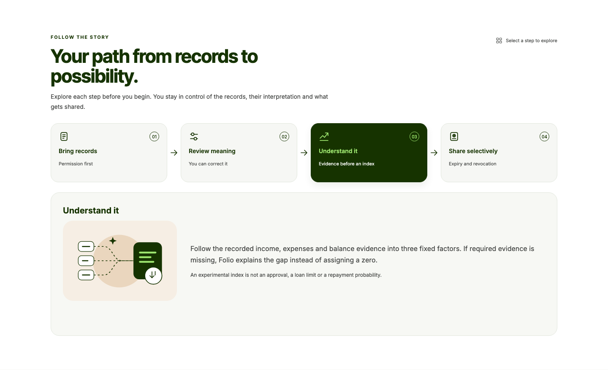

# FOLIO

**Credit beyond your credit history.** Permissioned financial records → review and correction → deterministic alternative assessment → portable financial passport → expiring sharing and revocation. An existing credit score is not required. This experimental scorecard is not a lending decision, repayment prediction, or promise of lender acceptance.



[Desktop assessment](docs/images/desktop-assessment.png) · [Mobile assessment](docs/images/mobile-assessment.png) · [Interactive cash-flow preview](docs/images/cashflow.png) · [Evidence flow](docs/images/evidence-explorer.png) · [Mobile flow](docs/images/mobile-evidence-explorer.png) · [Sharing flow](docs/images/sharing-explorer.png)

Screenshots use explicitly synthetic demo records.

## Visual experience

Three interactive flow explorers explain the borrower journey, trace actual records and corrections into the assessment, and show snapshot/disclosure/sharing boundaries. Ordered keyboard tabs, compact mobile layouts, reduced motion, contextual next steps and link-copy recovery complement the SVG illustrations, index ring and exact monthly cash-flow inspector. Every financial value comes from the existing deterministic contract; missing evidence stays unscored. See the [interactive-flow checkpoint](docs/checkpoint-flows.md) and [financial graphics checkpoint](docs/checkpoint-graphics.md) for checks, screenshots and independent Opus 5.5 review evidence.

## Core sponsor integrations

- **Capital One Nessie:** actual API reads from a dedicated synthetic customer, supported resource/capability checks, exact-money normalization, source references and persistent assessments/passports. The configured demo has three deposits and three withdrawals. Missing history and unclassified cash movements cause an honest unscored result.
- **Gemini:** actual server-side structured PDF extraction, classification/pattern suggestions and evidence-grounded questions through Google's SDK. Source IDs, citations and schemas are verified; code renders financial figures from deterministic metrics. The current configured model is `gemini-3.1-flash-lite`. Earlier `gemini-3.8-flash` requests succeeded, then reached its daily free-tier limit. No model or fixture is silently substituted on a failed request.
- **Tiger Data:** actual Tiger Cloud PostgreSQL/Timescale persistence. A transaction hypertable and owner/currency daily continuous aggregate power cash-flow history. Cloud cutover preserved **221 workspaces,10,710 records,235 assessments and61 shares**. Two actual app restarts retained corrections, immutable passports, sessions and revocation; another session was denied private passport/share operations.

Targets: Nessie, Gemini, Tiger Data, AI/ML, UI/UX and Overall, subject to the [official event rules](https://swamphacks-xii.devpost.com/rules). See the [category-to-feature demonstration checklist](docs/category-checklist.md), [actual sponsor evidence](docs/sponsor-map.md), [demo scripts](docs/demo.md) and [Devpost draft](docs/devpost-draft.md). The draft has not been submitted.

## Run locally

Active workspace: `/Users/myakubovich/Projects/FOLIO`. The original iCloud Documents repository is preserved; [recovery provenance](docs/recovery.md) explains the separate source recovery.

Node22.17+ is required. Next.js App Router and Express share a server; database access, provider keys and score math stay on the server.

```sh
gh repo clone myakubovich1/FOLIO
cd FOLIO
npm ci
# Only on a fresh checkout: copy .env.example to .env.local if absent.
# Enter credentials in the ignored local file, never chat or Git.
npm run dev
# http://localhost:3100
```

For production-mode rehearsal: `npm run build` then `npm start`. Do not rebuild while a production app/browser test server is running. Port3000 belongs to a separate application.

For service-free rehearsal, leave `DATABASE_URL` and external provider variables absent in a separate local configuration. The clearly labeled five-profile synthetic demo uses SQLite, calculated explanations, correction, PDF export and sharing/revocation without external services. A configured database failure never silently falls back.

For local Timescale: `docker compose up -d`; use the development URI from compose.yaml, then `npm run db:migrate` and `npm run db:seed`. For Tiger Cloud, set `DATABASE_URL` and follow [configuration](docs/configuration.md) and [database cutover](docs/database-transfer.md). The current free synthetic service uses an explicitly approved local certificate pin; no TLS verification bypass is enabled.

## Verify

```sh
npm run typecheck
npm run lint
npm test
npm run test:database # configured DATABASE_URL, synthetic test owners only
npm run build
npm run test:e2e
npm run providers:check
npm run providers:smoke
npm run eval:ai
npm run verify:persistence
npm run export:demo
```

`FOLIO_TEST_DATABASE_URL` enables actual database tests; keep that URI in local process configuration. `verify:persistence` starts temporary production app processes on3103 and cleans up its own synthetic workspaces. Live provider checks consume provider quota; they report actual failures instead of fixtures. Screenshots, PDF exports and sanitized machine-readable evidence live under `output/`. [Verification](docs/verification.md), [completion report](docs/completion.md), [verified evidence](docs/evidence.md) and [review cycle](reviews/PRODUCT-CYCLE.md) distinguish implementation, execution and external blockers.

With a Nessie key only: `npm run nessie:setup -- --apply` finds/creates the dedicated synthetic customer and saves its ID locally. `npm run nessie:seed` previews writes; `-- --apply` creates marked resources idempotently. `FOLIO_PUBLIC_SANDBOX=true` explicitly allows isolated public sessions to read that dedicated mock customer; it never enables arbitrary customer selection or private uploads. Default is false.

## Two-agent workflow

Codex is the sole builder/coordinator; Claude Code is the sole independent reviewer. Both receive `docs/project-brief.md` and `docs/assessment.md`. Claude reviews immutable Git exports using Read/Glob/Grep only, with no shell, edits, hooks, MCP servers or subagents.

```sh
# Resume Codex here, or after stopping this chat's builder:
npm run builder
# Review the exact committed snapshot:
env -u ANTHROPIC_API_KEY npm run review -- HEAD
```

For the requested Opus 5.5 reviews, an isolated CLI2.1.302 is installed under ignored `.workflow/claude-cli`; the global CLI is unchanged. To reproduce that optional setup:

```sh
npm install --prefix .workflow/claude-cli --no-audit --no-fund @anthropic-ai/claude-code@2.1.302
FOLIO_CLAUDE_CLI="$PWD/.workflow/claude-cli/node_modules/.bin/claude" \
FOLIO_REVIEW_MODEL=claude-opus-5-5 \
env -u ANTHROPIC_API_KEY npm run review -- HEAD
```

The process-local override uses the existing Claude Pro login. A simultaneous second reviewer is refused. Reports are `reviews/<commit>.json`; dispositions document verified fixes. A saved review can resume with `npm run review -- HEAD <session_id>` while its original temporary directory exists. Only assign independent Claude implementation with agreed contracts, a separate Git worktree/branch and explicit file ownership.

## Remaining external acceptance

Auth0 configuration is pending: actual two-account login/callback/logout and private upload acceptance cannot be certified by the isolated test-identity harness. A public HTTPS deployment, public repository URL, human team eligibility and Devpost submission also remain operator steps. Provider limits and latency can affect live rehearsal; calculated explanations remain explicitly available. No empirical repayment accuracy or complete WCAG certification is claimed.

[Architecture](docs/architecture.md) · [assessment contract](docs/assessment.md) · [imports](docs/imports.md) · [evaluation](docs/evaluation.md) · [visual specification](docs/visual-spec.md) · [deployment](docs/deployment.md) · [credits](docs/sponsor-map.md)
